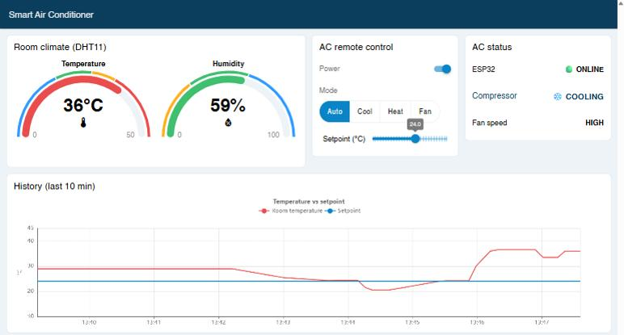
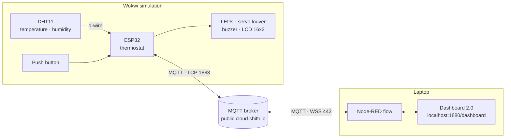
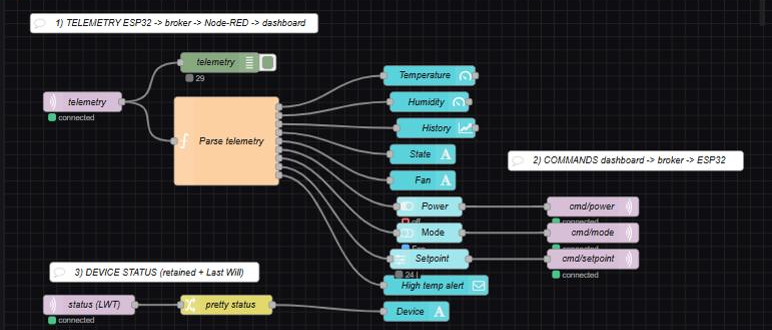
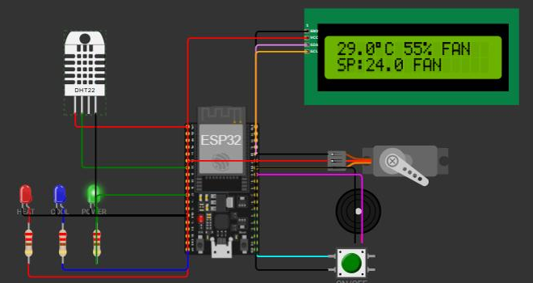
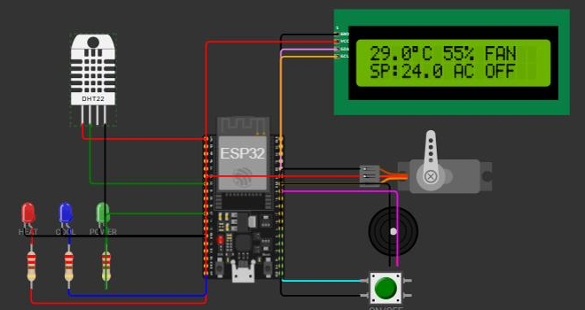
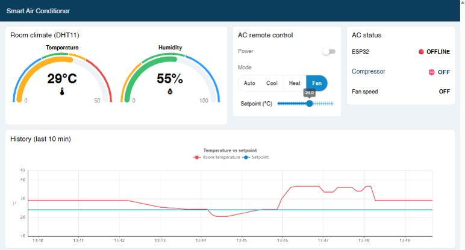

<div align="center">

# ❄️ Smart AC IoT

### A connected air conditioner on ESP32, driven over MQTT and controlled from a Node-RED dashboard

*An ESP32 reads the room with a DHT11, runs a thermostat with hysteresis, drives a cooling stage, a heating stage and a swinging louver, publishes its state over MQTT and obeys remote commands from a Node-RED dashboard. Fully simulated on Wokwi and tested end to end on a real public broker.*

<br/>

[](https://www.espressif.com/en/products/socs/esp32)
[](https://www.arduino.cc)
[](https://mqtt.org)
[](https://nodered.org)
[](report/Rapport_Smart_AC_IoT.pdf)

[](https://wokwi.com/projects/481300995020006401)
[](#-tests)
[](#)

</div>

---

<div align="center">

<br/><sub>Node-RED dashboard during the test scenario: room at 36 °C, compressor cooling at high fan speed</sub>
</div>

---

## 🎯 1. Objective

Simulate a connected air conditioner for the Internet of Things course at École Nationale Polytechnique (ENP, Algiers):

- measure the room temperature and humidity with a **DHT11** on an **ESP32**;
- decide to cool or heat with a **thermostat with hysteresis**;
- exchange data with the application through the **MQTT** protocol;
- **monitor and control** the unit remotely from a **Node-RED** dashboard;
- detect when the device goes **offline** and raise an **alert** when the room overheats.

## Why this project is worth a look

| | |
|---|---|
| **Real network, not a mock** | The simulated ESP32 talks to a public MQTT broker on the Internet, and Node-RED runs on a real laptop. Every test went through the full chain. |
| **Bidirectional MQTT** | Telemetry goes up every 2 s; power, mode and setpoint commands come down and are applied instantly, then confirmed by a fresh telemetry message. |
| **Last Will online status** | The ESP32 registers a retained Last Will, so the dashboard shows **OFFLINE** by itself when the device disappears. |
| **Hysteresis control** | A 1 °C band protects the compressor from rapid on/off cycling. |
| **Works behind a firewall** | The local network blocked port 1883, so Node-RED connects with MQTT over secure WebSocket on port 443. The device and the logic did not change. |
| **Documented** | A 23-page LaTeX report with diagrams, code walkthrough and screenshots of every test. |

---

## 🏗️ 2. Architecture



| Layer | Content |
| --- | --- |
| Perception | DHT11 sensor and actuators (LEDs, servo, buzzer, LCD, button) |
| Network | Wi-Fi (`Wokwi-GUEST`), MQTT over TCP 1883 for the ESP32 and over WebSocket 443 for Node-RED |
| Application | Node-RED flow and FlowFuse Dashboard 2.0 (gauges, chart, controls, alerts) |

## 🔌 3. Components and wiring

<div align="center">

<br/><sub>The circuit in Wokwi while cooling: blue LED on, LCD showing temperature, humidity, mode, setpoint and state</sub>
</div>
<br/>

| Component | Role | ESP32 pin |
| --- | --- | --- |
| DHT11 (DHT22 part in Wokwi) | Temperature and humidity | DATA → GPIO 32, VCC 3V3 |
| Blue LED + 220 Ω | Compressor **cooling** | GPIO 26 |
| Red LED + 220 Ω | **Heating** (heat pump) | GPIO 25 |
| Green LED + 220 Ω | Unit powered **ON** | GPIO 27 |
| Servo motor | Swinging air louver, speed = fan speed | PWM → GPIO 18, 5V |
| Buzzer | Beep when a command is received | GPIO 19 |
| LCD 16x2 I²C (0x27) | Local display | SDA GPIO 21, SCL GPIO 22 |
| Push button | Local ON/OFF | GPIO 4 (`INPUT_PULLUP`) |

> **Note.** Wokwi has no DHT11 part, so the DHT22 is used: it speaks the same single-wire protocol and uses the same library. On real hardware only `#define DHT_TYPE DHT11` changes.

## 📡 4. MQTT

All topics share the prefix `enp/zaki/ac/` to avoid collisions on the public broker.

| Topic | Direction | QoS | Payload |
| --- | --- | :---: | --- |
| `enp/zaki/ac/telemetry` | ESP32 → Node-RED | 0 | JSON every 2 s and after each command |
| `enp/zaki/ac/status` | ESP32 → Node-RED | 1 | `online` (retained), Last Will `offline` |
| `enp/zaki/ac/cmd/power` | Node-RED → ESP32 | 1 | `ON` · `OFF` · `TOGGLE` |
| `enp/zaki/ac/cmd/mode` | Node-RED → ESP32 | 1 | `AUTO` · `COOL` · `HEAT` · `FAN` |
| `enp/zaki/ac/cmd/setpoint` | Node-RED → ESP32 | 1 | 16 to 30 °C |

```json
{"temp":29.0,"hum":55.0,"setpoint":24.0,"power":"ON","mode":"AUTO","state":"COOLING","fan":3}
```

**Broker.** `public.cloud.shiftr.io` (user and password `public`). The ESP32 uses plain MQTT on port 1883; Node-RED uses `wss://public.cloud.shiftr.io` on port 443, because the laptop's network blocks non-web ports.

## 🧠 5. Control algorithm

Thermostat with hysteresis, `H = 1 °C`:

```text
if power = OFF            -> everything off, louver closed
else if mode = FAN        -> compressor off, fan MEDIUM
else
   COOL allowed (AUTO/COOL): start if T >= SP + H, stop when T <= SP
   HEAT allowed (AUTO/HEAT): start if T <= SP - H, stop when T >= SP
   fan speed = LOW if |T - SP| < 2, MEDIUM if < 5, HIGH otherwise
```

The hysteresis band avoids switching the compressor on and off at every small fluctuation around the setpoint. The servo sweeps the louver between 45° and 135°, faster at higher fan speed, and closes it when the unit is off.

## 💾 6. ESP32 program

1. **`setup()`**: pins, LCD, DHT, servo, Wi-Fi, `mqtt.setServer()`, `mqtt.setCallback()`.
2. **`connectMqtt()`**: non-blocking retry every 3 s, connection with the Last Will, publish `online` (retained), subscribe to `enp/zaki/ac/cmd/#`.
3. **`loop()`**: `mqtt.loop()`, push button with debounce, and every 2 s: read the DHT → `updateControl()` → LCD → publish telemetry. The louver animation runs continuously.
4. **`onMqttMessage()`**: parse and validate the command (out-of-range setpoints are rejected), beep, recompute and publish immediately.

Libraries: `WiFi`, `PubSubClient`, `DHT sensor library`, `LiquidCrystal I2C`, `ESP32Servo`.

## 🧩 7. Node-RED flow

<div align="center">

</div>
<br/>

| Part | Nodes |
| --- | --- |
| Telemetry | `mqtt in` (JSON) → `function` "Parse telemetry" with 9 outputs → gauges, history chart, state and fan texts, high-temperature alert, control re-sync |
| Commands | `ui-switch` Power, `ui-button-group` Mode, `ui-slider` Setpoint → `mqtt out` on the matching `cmd/` topic (QoS 1) |
| Device status | `mqtt in` on `status` → `change` (JSONata) → "🟢 ONLINE" / "🔴 OFFLINE" |

The function only re-sends the control values when they change (and every fifth message), so the local button and the dashboard always agree and the slider does not jump while it is being moved.

## ✅ 8. Tests

| # | Action | Observed result |
| --- | --- | --- |
| T1 | Start at 29 °C, setpoint 24 °C, AUTO | Blue LED on, COOLING, fan HIGH, dashboard ONLINE |
| T2 | Room cooled step by step | Fan HIGH → MEDIUM → LOW; compressor stops at 23.9 °C and stays off up to 24.4 °C |
| T3 | Room at 20.5 °C | Red LED on, HEATING; stops at 24.0 °C |
| T4 | Room at 36.5 °C | COOLING at HIGH speed and a red alert on the dashboard |
| T5 | Dashboard: mode FAN | `[SUB] cmd/mode <- FAN`, beep, compressor off, fan MEDIUM |
| T6 | Dashboard: setpoint 30 °C at 29 °C | HEATING, fan LOW |
| T7 | Dashboard: power OFF | All LEDs off, louver closed, LCD "AC OFF" |
| T8 | Stop the simulation | Last Will published, dashboard shows OFFLINE |
| T9 | Short network interruption | `failed, rc=-2` then `OK`: automatic reconnection |

<div align="center">



<br/><sub>Heating · Fan mode from the dashboard · Unit off</sub>
<br/><br/>

<br/><sub>After the simulation stops: the Last Will turns the device OFFLINE, and the chart shows the whole scenario</sub>
</div>

---

## 🚀 Running it

**1. Device (Wokwi).** Open the [Wokwi project](https://wokwi.com/projects/481300995020006401) and press ▶. Or create a new ESP32 project and paste the three files from `firmware/`. The serial monitor shows `MQTT connecting... OK`. Click the DHT sensor to change the temperature and humidity.

**2. Node-RED (Windows).** Double-click `node-red/start-node-red.bat`. On the first run it installs Node-RED and Dashboard 2.0 and imports `flows.json`. Keep the window open.

```powershell
# manual alternative
npm install -g --unsafe-perm node-red
cd $env:USERPROFILE\.node-red
npm install @flowfuse/node-red-dashboard
node-red
```

Then import `node-red/flows.json` (menu → Import) and deploy if needed.

**3. Dashboard.** Open `http://localhost:1880/dashboard/ac`.

> Keep the Wokwi tab visible: browsers throttle hidden tabs and the simulation slows down.

* * *

## 📁 Project structure

```text
firmware/
  sketch.ino            ESP32 firmware (Arduino C++)
  diagram.json          Wokwi circuit
  libraries.txt         Wokwi library list
node-red/
  flows.json            Node-RED flow and Dashboard 2.0 layout
  start-node-red.bat    one-click install, import and start on Windows
report/
  report.tex            LaTeX source of the report
  Rapport_Smart_AC_IoT.pdf
  fig/                  Wokwi and Node-RED screenshots
  code/                 firmware copy and serial log used by the report
```

## 🛠️ Stack

ESP32 · Arduino C++ · PubSubClient · DHT sensor library · LiquidCrystal I2C · ESP32Servo · MQTT · shiftr.io public broker · Node-RED · FlowFuse Dashboard 2.0 · Wokwi · LaTeX (TikZ, pgfplots)

## 🔬 Known limitations

- The public broker has no access control: anyone who knows the topics can read them or send commands. A real product needs a private broker, TLS and per-device credentials.
- The DHT11 is only accurate to ±2 °C; a DHT22 or SHT31 would allow a narrower hysteresis band.
- LEDs stand for the compressor and the heater; real hardware would drive relays with a minimum off-time.
- The room temperature is set by hand in Wokwi; there is no thermal model of the room.

## 📄 Report

The full report is in [`report/Rapport_Smart_AC_IoT.pdf`](report/Rapport_Smart_AC_IoT.pdf): architecture, MQTT design and sequence diagram, control logic and state machine, firmware walkthrough, Node-RED implementation, tests and discussion. The LaTeX source compiles with `pdflatex` or on Overleaf.

* * *

Built by [ZakiANK04](https://github.com/ZakiANK04)
